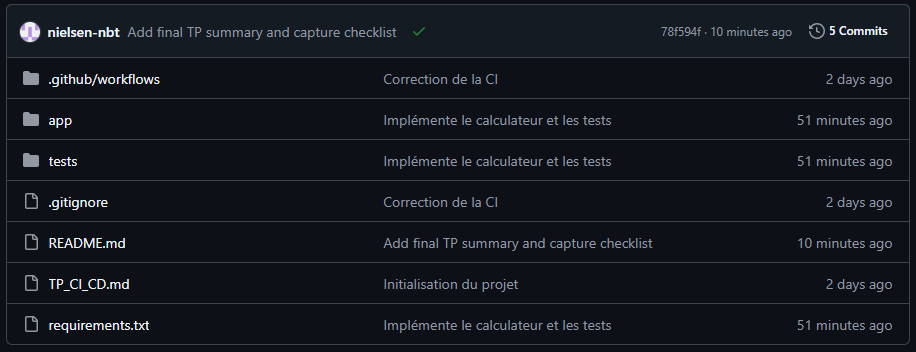
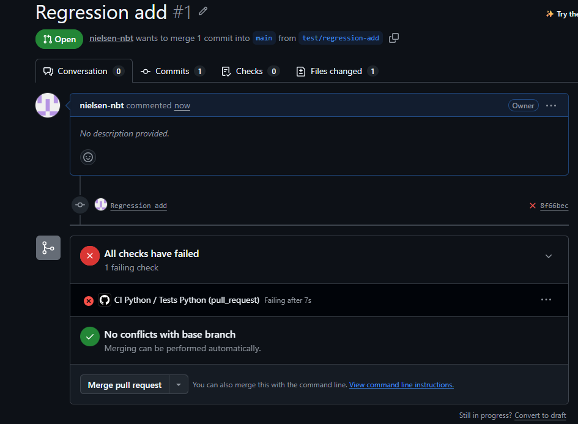
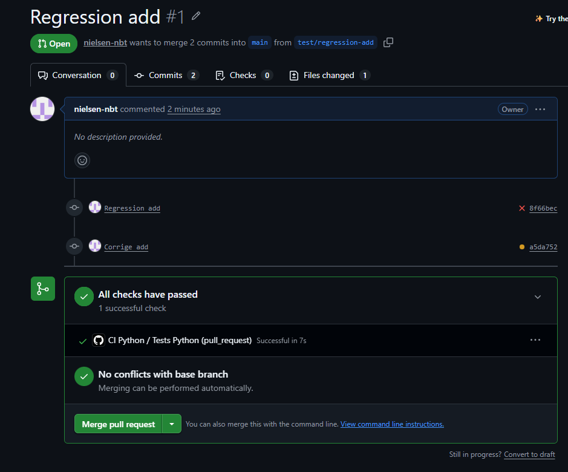

# TP GitHub Actions - CI/CD


## Réponses au questionnaire

### 1. Quelle est la différence entre `git init`, `git add` et `git commit` ?

* `git init` permet de créer un dépôt Git local dans le dossier du projet.
* `git add` prépare les fichiers modifiés ou créés pour le prochain commit (zone d'index).
* `git commit` enregistre définitivement ces modifications dans l'historique Git avec un message descriptif.

### 2. Dépôt local, dépôt distant et commandes associées

* **Différence local / distant :** Le dépôt local est stocké sur mon ordinateur, alors que le dépôt distant est hébergé en ligne sur GitHub pour sauvegarder le projet et travailler à plusieurs.
* **`origin` :** C'est le nom par défaut donné au dépôt distant lorsqu'on le relie au projet avec `git remote add origin ...`.
* **`git push` :** Cette commande sert à envoyer les commits locaux vers le dépôt distant sur GitHub.
* **Option `-u` :** Dans `git push -u origin main`, elle permet d'associer la branche locale `main` à la branche distante `origin/main` pour simplifier les prochains `git push` et `git pull`.

### 3. Environnement virtuel et test de division par zéro

* **Intérêt d'un environnement virtuel :** Il isole les bibliothèques Python du projet (comme `pytest`) afin d'éviter les conflits de versions avec les paquets déjà installés sur le système.
* **Test de division par zéro :** Le test réussit parce qu'il vérifie justement que le programme lève bien une exception `ZeroDivisionError` lors d'une division par `0`, grâce à `pytest.raises(ZeroDivisionError)`.

### 4. Pourquoi le premier push sur `main` déclenche-t-il automatiquement la CI ?

Parce que le fichier `.github/workflows/ci-cd.yml` est configuré pour déclencher le workflow à chaque événement `push` sur la branche `main` :

```yaml
on:
  push:
    branches:
      - main
```

Dès qu'un push arrive sur `main`, GitHub Actions lance donc automatiquement les tests, même sans pull request.

### 5. Pourquoi le test détecte-t-il la régression et qu'apporte le journal ?

* **Détection de la régression :** Le test `test_add` vérifie que `add(2, 3)` retourne `5`. En remplaçant l'addition par une soustraction, la fonction renvoie `-1`, donc l'assertion échoue immédiatement.
* **Utilité du journal (logs) :** L'icône rouge indique seulement qu'une étape a échoué, tandis que le journal détaille l'étape exacte en erreur, le nom du test concerné, la valeur attendue (`5`) et la valeur obtenue (`-1`).

---

## Diagnostic et correction

Pour tester le fonctionnement de la CI sur une pull request, j'ai volontairement introduit une erreur dans `app/calculator.py` sur la branche `test/regression-add` en remplaçant `a + b` par `a - b`. La CI a bloqué la pull request avec une erreur sur `test_add`.

J'ai ensuite remis la bonne opération :

```python
def add(a, b):
    return a + b
```

Après un nouveau push sur la branche, la CI est repassée au vert et j'ai pu fusionner la pull request sur `main`.

### Validation locale

Commande exécutée :

```bash
python -m pytest -v
```

Résultat obtenu :

```text
6 passed in 0.34s
```

---

## Bilan et compte rendu

* **Nom du dépôt GitHub :** `TP_GitHub-Projects_CI-CD`
* **URL du dépôt :** https://github.com/nielsen-nbt/TP_GitHub-Projects_CI-CD
* **Branche principale :** `main`
* **Test en échec lors de la régression :** `test_add` (cause : remplacement temporaire de `+` par `-` ; correction : remise de `return a + b`).
* **Différence test local / CI GitHub :** Un test local vérifie le code uniquement sur ma machine et son environnement, alors que la CI GitHub exécute automatiquement les tests sur une machine virtuelle propre à chaque push ou pull request.

### Captures d'écran

**1. Arborescence du dépôt sur GitHub**


**2. Pull Request avec le contrôle en échec (rouge)**


**3. Pull Request après correction (vert)**
